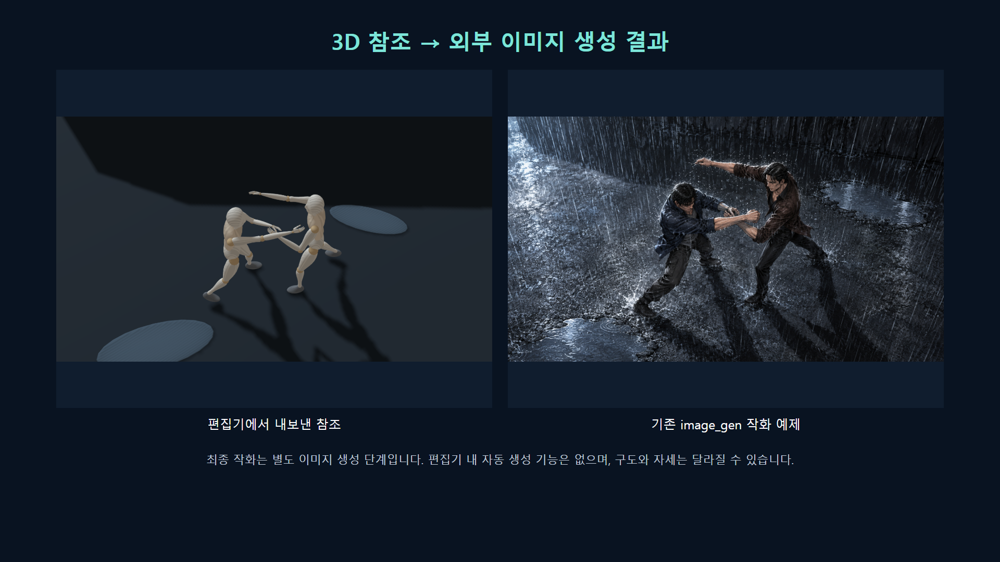

# 로컬 컷신 스튜디오

소설에서 LLM이 제안한 공간·인물·카메라·조명을 불러와 직접 수정하고, 이미지 생성용 참조를 촬영하는 로컬 도구입니다. Python 대신 JavaScript와 Three.js를 사용합니다. [pose-toolkit](https://github.com/fanverseio/pose-toolkit)을 기반으로 확장했습니다.

## 예제와 사용 영상

[예제·결과 갤러리](docs/EXAMPLE_GALLERY.md) · [42초 기능 소개 · X용 MP4](docs/demo/social/cutscene-studio-x.mp4) · [빠른 영상 시나리오](docs/DEMO_SCENARIO_SOCIAL.md) · [개발 과정](docs/DEVELOPMENT.md)

기본 포즈 변경, 포즈 저장·복원, 내 포즈 라이브러리, 구도 저장, 거리·광원 참조, 작화 비교를 빠르게 볼 수 있습니다. [80초 사용 흐름 영상](docs/demo/cutscene-studio-demo.webm)도 제공합니다.



## 실행

공개 저장소를 클론해 실행할 수 있습니다.

[저장소 인계와 새 설치 확인 결과](docs/REPOSITORY_HANDOFF.md)도 함께 확인하세요.

```powershell
git clone https://github.com/nothing2that-sys/cutscene-studio.git D:\github\cutscene-studio
Set-Location D:\github\cutscene-studio
npm --prefix app ci
npm --prefix app run build
.\start.cmd
```

외부 검증이나 새 PC의 `D:\github\<레포명>`에서 시작한다면 [외부 검증 인계 문서](docs/EXTERNAL_REVIEW.md)를 먼저 읽으세요. 저장소 포함 범위, 새 설치, 자동·수동 검증, 알려진 제약과 검증 AI용 요청문을 정리했습니다. 결과는 [검증 보고서 양식](docs/EXTERNAL_REVIEW_REPORT_TEMPLATE.md)에 남길 수 있습니다.

이 작업 폴더에서 `start.cmd`를 실행하고 브라우저로 http://127.0.0.1:3001 을 여세요. 소스 클론 후에는 아래 명령으로 `app/dist`를 먼저 빌드합니다. 편집 중 외부 API나 인터넷 연결이 필요하지 않습니다. 실행기는 `CUTSCENE_NODE` 설정, PATH의 Node.js, 프로젝트 내부 `.review-tools/node/node.exe` 순으로 찾습니다. 특정 PC의 Codex 설치 경로는 필요하지 않습니다.

다른 PC나 소스만 복사한 경우 Node.js 20.19 이상인 20.x 또는 22.12 이상과 npm을 설치한 뒤 `app`에서 다음을 실행합니다. 검증 환경은 Node.js 24.22.2입니다. 최초 의존성 설치에는 인터넷 연결이 필요합니다.

```powershell
npm ci
npm run build
```

이후 루트 폴더의 `start.cmd`를 사용합니다. 개발 중에는 `app`에서 `npm run dev`를 사용할 수 있습니다. 포트는 3001이며 서버는 로컬 주소에만 바인딩합니다.

## 사용 순서

기본 조작은 **인물 이동 / 포즈 잡기 / 세부 조정**으로 나뉩니다. 몸을 잡아 통째로 옮기고, 포즈 모드의 이름 붙은 무릎·발목 원을 끌어 자세를 바꿉니다. **내 포즈**에는 초기 참조 10개와 작업 중 자동 저장한 자세가 쌓입니다. [직접 조작과 포즈 라이브러리 사용법](docs/DIRECT_EDITING.md)을 먼저 참고하세요.

1. 왼쪽 **예제 장면**으로 두 인물·탁자·상자가 있는 장면을 엽니다.
2. 소설을 [장면 작성 지침](prompts/scene-planner.md)과 함께 LLM에 전달합니다. 생성된 JSON은 **장면 JSON 열기** 또는 붙여넣기로 적용합니다.
3. 인물·소품을 클릭하거나 오른쪽 목록에서 고릅니다. 인물 이동으로 통째로 옮기거나 포즈 잡기의 원을 끌어 조정합니다. 세부 조정에서 기존 관절 슬라이더와 기즈모를 쓸 수 있습니다. 빈 공간을 드래그하면 시점을 회전하고 휠로 거리를 조정합니다.
4. 왼쪽에서 방 크기·벽·빛을 조절합니다. 작업 화면을 돌려 구도를 찾고 **구도 저장**을 누릅니다. 기존 컷은 **갱신**으로 현재 카메라를 저장합니다.
5. 촬영 미리보기를 확인하고 **PNG 캡처**, 필요하면 **Depth PNG**를 저장합니다. 정밀 작업 상태는 위쪽 **Save**로 저장하고 **Load**로 다시 엽니다.
6. 최종 이미지 생성에는 캡처, 캐릭터 정본 이미지, **작화 지시문**을 전달합니다. **LLM 전달 묶음**은 컬러·깊이 이미지의 data URL, 정밀 프로젝트와 지시문을 담은 JSON입니다. 일반 이미지 생성 UI에서는 별도 PNG를 직접 첨부하는 편이 편리합니다.

## 현재 구현 범위

- LLM용 장면 JSON 검증과 배치, 인물 기본 포즈 4종
- 기존 마네킹 관절·IK·이동·회전·GLB 가져오기 기능 재사용
- 방, 상자·탁자·의자·구체, 주광 방향·색·세기와 주변광 조정
- 작업 카메라와 저장된 촬영 카메라 분리, 여러 카메라 컷, 화면비 변경
- 가이드·선택 강조 없는 컬러 PNG와 선형 깊이 PNG, 긴 변 1600픽셀
- 관절·소품·공간·카메라·컷을 포함하는 프로젝트 저장과 되돌리기
- LLM 전달용 이미지·정밀 상태·작화 지시문 내보내기

카메라 컷은 현재 동일한 인물·포즈·공간을 공유합니다. 컷별로 다른 동작을 저장하려면 별도 프로젝트 파일을 사용하세요. 컷별 포즈 상태, 접촉·접지 제약, OpenPose 출력과 VRM은 후속 고도화 대상입니다. **소설 → 장면 → 이미지**에서 소설 입력부터 장면 구성·최종 작화까지 연결할 수 있습니다. 로그인된 Codex CLI가 기본이며 OpenAI/Gemini API를 각각 선택할 수도 있습니다. **장면만 구성** 후 구도를 수정하고 이어서 생성하는 흐름도 지원합니다. [연결·사용법·검증 범위](docs/AI_WORKFLOW.md). 일반 이미지 참조만으로 생성 모델의 정확한 구도 보존을 보장하지 않습니다.

정밀 프로젝트의 `studio.initialProposal`과 전달 묶음의 `proposal`은 최초 장면 제안을 보존합니다. `studio.document`의 공간·조명·제목·원문은 현재 편집값이며, 인물·소품 배치와 관절은 `mannequins`·`importedModels`가 기준입니다. 전달 묶음의 `editorState`는 이 현재 상태 전체를 담습니다. 구형 프로젝트는 최초 제안을 복원할 수 없어 `proposalOrigin: legacy-current-state`로 표시합니다. 인물이 없는 장면도 지원하며 Delete 키와 목록 휴지통 모두 마지막 인물을 삭제할 수 있습니다.

## 설계와 출처

- [오픈소스 조사와 채택 판단](docs/OPEN_SOURCE_RESEARCH.md)
- [고도화 설계와 구현 순서](docs/DESIGN.md)
- [조사한 11개 프로젝트와 소스 경로](research/sources.json)
- [재사용 코드와 라이선스](THIRD_PARTY_NOTICES.md)
- [로컬 검증 결과](docs/VALIDATION.md)

## 검증 명령

```powershell
node --test scripts/scene-format.test.mjs scripts/scene-feedback.test.mjs
```

브라우저 검사는 `npm install --prefix .review-tools --no-save playwright`와 Google Chrome 설치 후 실행합니다. 스크립트는 프로젝트의 Playwright를 찾아 사용하므로 개발 PC 경로나 `NODE_PATH` 수정이 필요하지 않습니다. 서버와 검사 순서는 [외부 검증 인계 문서](docs/EXTERNAL_REVIEW.md)를 참고하세요. IK 연속성은 `scripts/ik-continuity-check.mjs`, 잔여 결함 회귀는 `scripts/review-regression-check.mjs`로 확인합니다.

## 코덱스 통합 스킬

설치된 전용 스킬은 $cutscene-studio입니다. 예: $cutscene-studio 이 소설에서 필요한 컷을 골라 편집기용 장면 JSON을 만들어줘.

소설 해석·장면 JSON 작성과 검증·수정본 확인·작화를 한 진입점으로 연결합니다. 포즈 검색과 융합은 필요한 경우에만 요청합니다. [통합 결과와 백업 위치](docs/SKILL_INTEGRATION.md), [스킬 원본](skills/cutscene-studio/SKILL.md)을 참고하세요.

## JSON 오류를 코덱스에 전달하기

JSON 붙여넣기에서 검사만 또는 장면 적용을 누르면 오류·경고 목록이 표시됩니다. 오류는 적용을 차단하고 기존 장면을 유지합니다. 경고는 의도한 배치인지 확인할 항목이며 적용할 수 있습니다. LLM 수정 요청 복사를 눌러 이 대화에 붙여넣거나 보고서 저장으로 받은 JSON을 전달하세요. 원본 입력과 오류 경로가 함께 들어 있어 같은 JSON을 수정해 돌려받을 수 있습니다. 클립보드가 제한되면 선택 가능한 텍스트가 표시됩니다.

정밀 프로젝트의 구조도 Load 전에 검사합니다. 일부 공간 경고는 간단한 수치 조건이며, 실제 접촉·가림·시선·구도는 촬영 미리보기에서 확인해야 합니다.

## 인물 체형과 포즈

새 인물은 공통 작화 인체 v1을 사용합니다. 인물 선택 후 관절을 편집하고 **앵글 고정 · 선화**로 전환하세요. 고정 화면은 드래그·휠로 이동·확대하며, 인물/소품의 XYZ·자세·가림이나 카메라가 바뀌면 장면 선화를 갱신합니다.

오른쪽 **공통 인체 · 추정 자세**의 원본/P015 버튼은 선택 인물에 명시된 새 추정 자세, 위치·발 지지와 작업 카메라를 적용합니다. 원본은 자연스러운 발 지지를 택한 대안 추정이며 P015는 같은 몸체의 다른 자세 교차 확인입니다. 두 그림의 유일한 3D 복원이라고 표시하지 않습니다. 저장한 명시 관절 자세는 추정 자세 이름으로 다시 생성하지 않습니다.

손발은 닫힌 단순 외피입니다. 손바닥·발바닥 방향과 지지점은 3D에서 정하고, 손가락·발가락·손톱·피부·장갑·신발 세부는 인물 설명으로 전달합니다. 컬러·깊이·설명 전달 묶음은 같은 현재 장면을 사용합니다.

공통 v1은 기본 8등신 몸체와 키 조절을 지원합니다. 기존 파일의 다른 체형과 가슴 형태 참조는 기존 인체 표시를 유지하며 조용히 v1로 바꾸지 않습니다. 팔꿈치·무릎의 지원 각도를 줄여 접촉 문제를 감추지 않습니다. 현재 접촉/성능/시각 검증의 상태와 사용법은 [작화 인체 v1](docs/ARTICULATED_BODY_V1.md)에 기록합니다.
