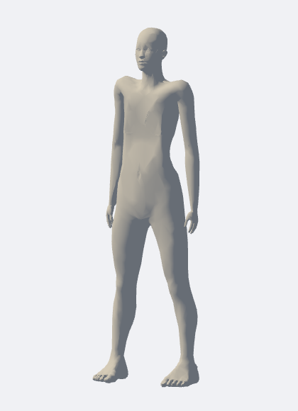
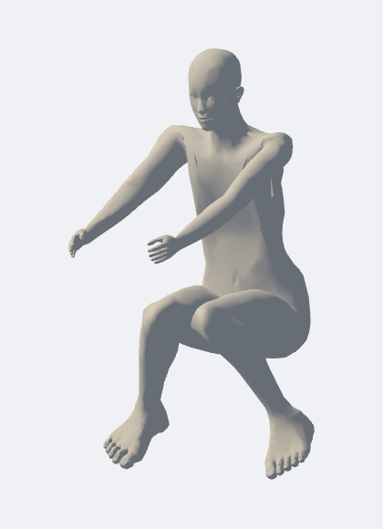

# 연속 인체 모형과 포즈 편집

> 이전 버전의 구현·검증 이력입니다. 현재 기본 모형은 사용자 레퍼런스에 맞춘 [작화용 인체](ILLUSTRATION_BODY.md)입니다. 아래 단일 연결 몸 표면·1 draw call 수치는 이전 버전에 해당합니다.

2026-11-02. 기본 인체 표시를 분리된 부위 볼륨에서 **연속된 피부가 관절을 따라 변형되는 인체 메시**로 교체했습니다. 빌드 후 `http://127.0.0.1:3001`을 Ctrl+F5로 새로고침하세요.

## 사용

- 기본 **인체형 · 무채색**에서는 얼굴·손가락·발가락이 있는 인체만 표시합니다. 관절 공이나 편집점은 기본 화면에 표시하지 않습니다.
- 인물을 선택하고 **포즈**로 전환하면 선택 인물의 무릎·발목 등 조작점이 나타납니다. 단독 편집을 켜면 다른 인물·사물은 편집 중에 숨겨집니다. **이동**으로 돌아오면 조작점도 사라집니다.
- 인체를 드래그해 인물 전체를 옮기거나, 기존 저장 포즈·변환 포즈를 적용합니다. 기존 키·등신·가슴 설정, 고정 뼈 길이, 프로젝트 저장 포맷을 유지했습니다.
- 상단 인체 표시에서 **기존 관절 마네킹**으로 비교할 수 있습니다. 표시 선택은 브라우저에 저장됩니다.

## 구현과 출처

[MakeHuman 공식 저장소](https://github.com/makehumancommunity/makehuman/tree/a8bc2d54ff0ac92e78ff71431b1023eda42bf482)의 CC0 인체 메시·기본 리그 가중치·작은 가슴 형태 데이터를 사용했습니다. [공식 라이선스 구분](https://github.com/makehumancommunity/makehuman/blob/a8bc2d54ff0ac92e78ff71431b1023eda42bf482/LICENSE.md) 및 [CC0 전문](../app/public/licenses/MakeHuman-ASSETS-CC0.txt). MakeHuman 프로그램 코드는 복사하지 않았습니다.

몸과 두 눈 표면만 남겨 6,000정점·11,988삼각형으로 줄였습니다. 몸 표면은 구멍 없는 한 연결 성분이며 눈 두 개는 별도 닫힌 성분입니다. 기존 리그와 손가락에 46개 바인딩을 연결하고 정점당 최대 4개 가중치로 GPU 스키닝합니다. 중립 흉곽 형태와 선택적인 가슴 볼륨을 연속 표면에 적용합니다. 기존 관절 좌표·회전·뼈 길이는 표시 전환으로 바꾸지 않습니다.

원본 출처·고정 커밋·SHA-256은 `app/src/assets/reference-human.source.json`, 가공 데이터는 `reference-human.json`에 있습니다. 로컬 의존성 설치 후 `node scripts/build-human-skin.mjs --download`로 원본 해시 확인과 오프라인 가공을 재현할 수 있습니다. 일반 앱 실행에는 원본 다운로드·Python·MakeHuman 설치가 필요 없습니다.

깊이 캡처도 같은 스키닝과 양면 렌더링을 사용합니다. 접지·선택 중심·근사 겹침 검사는 변형된 피부 외곽을 사용하도록 조정했습니다. 인물 클릭은 관절별 근사 상자를 사용하며 매번 모든 삼각형을 검사하지 않습니다.

## 실행 검증

실제 Chrome의 소스 서버(3002)와 빌드 서버(3001)에서 실행했습니다. [검증 JSON과 이미지](review-evidence/2026-11-02-continuous-skin/).

| 검사 | 결과 |
|---|---|
| 기존 17개 + 피부 연결성/가중치 2개 단위 테스트 | 19/19 통과 |
| 중립·웅크림·무릎꿇기·팔 올리기·비틀기·눕기 | 유한 정점, 뼈 길이·루트 보존; 컬러/깊이 전경 마스크 IoU 모두 1.0 |
| 키 1.55/1.75/1.95m, 5/8/9.5등신 | 중립 표면 키 오차 5mm 미만; 설정·뼈 보존 |
| 인체/관절형 전환, 가슴·체형 재설정 | 포즈·루트·뼈 보존; UI 설정 재열기 통과 |
| 전체 인물 드래그, 무릎·발목 조절, 포즈 저장/재적용 | 소스·배포본 통과 |
| 변환 포즈 1,001개 형식·출처 검증 | 통과; 선택 인물 적용·접지·Undo/Redo 통과 |
| 보정 포즈 466개 × 3체형 | 1,398회 적용; 최대 뼈 길이 편차 3.34e-16m 미만 |
| 단독 편집과 캡처 | 유휴 GPU 호출 0, 전체 장면 컬러 PNG 동일, 깊이 1600×900 유지 |
| 대상 설명·전달 묶음·카메라 이동 | 실제 컬러/깊이 내보내기·저장/Load·Undo/Redo 통과 |
| 프로덕션 빌드 | 성공; 인체 데이터 포함 단일 JS 약 1.40MB, gzip 약 399KB |

고립된 인물 1명에서 기존 관절형 대비 draw call **97 → 1**, 삼각형 **20,220 → 11,988**을 관측했습니다. FPS나 저사양 PC 전체 속도 향상률을 측정한 결과는 아닙니다. 연속 피부에는 스키닝 연산과 체형 재설정 시 바인딩 비용이 있습니다.

## 제한

포즈·구도 참고용의 가벼운 인체입니다. 레퍼런스 사진의 특정 인물·얼굴·옷을 복제하지 않습니다. 깊은 관절 접힘·어깨 비틀림에는 눌림이나 자기 침투가 남을 수 있으며 근육·피부 접촉을 물리적으로 계산하지 않습니다. 표면 연결성 검사와 유한 좌표 검사가 해부학적 완벽함을 보장하지는 않습니다.

기존 관절형의 부품 외곽과 새 피부의 외곽은 다릅니다. 표시 전환은 관절·루트를 보존하므로, 깊게 접힌 자세에서는 바닥과의 간격도 약간 달라질 수 있습니다. 포즈 적용의 접지와 체형 변경의 발 높이 보정은 현재 표시 표면을 기준으로 계산합니다. 키·등신 설정값을 유지하지만 구부린 자세의 전체 외곽 높이는 키와 다릅니다.

기존 261개 미해결 포즈의 원본 일치도는 이번 표시 개선으로 해결됐다고 처리하지 않았습니다. 기본 인체 표시의 변경이며 저장된 포즈 보정 데이터를 덮어쓰지 않았습니다.
