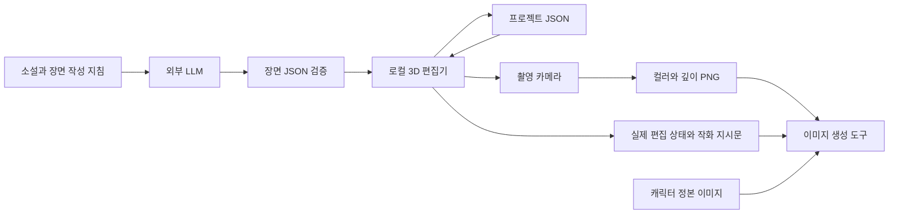

# 로컬 컷신 편집기의 고도화 설계

사용자는 소설 내용을 바탕으로 추천받은 구도를 3D에서 다듬고 작화 참조로 내보냅니다. 최적화할 대상은 재생성 횟수보다 **장면을 이해하고 고치기 위해 반복하는 수작업**입니다. LLM은 장면 해석과 초기 추천을 맡고, 편집기는 결정된 공간·카메라·포즈를 유지합니다.

## 현재 구조

편집기는 Three.js·Mannequin.js·JavaScript를 Vite로 묶어 로컬 파일 서버에서 실행합니다. 최초 설치와 빌드 후에는 웹폰트·CDN·LLM 호출 없이 편집할 수 있습니다. 정적 서버는 Node.js 표준 라이브러리만 사용하며 서버로 원고·이미지를 전송하는 API가 없습니다. 모델·텍스처 파일을 사용자가 추가할 경우 그 자산도 로컬에서 가져와야 오프라인 구성이 유지됩니다.

## 데이터와 좌표

장면 제안 포맷은 `version: 1`, `units: meters`, Y가 위인 오른손 좌표계입니다. 방은 원점 중심이고 바닥은 Y=0입니다. 인물의 `position`은 포즈 적용 후 양발 등 인체 최저점의 기준 위치이며, 소품의 `position`은 바닥면 중심입니다. 방·소품 크기는 `[너비, 높이, 깊이]`입니다. `yaw`와 관절 속성은 도 단위입니다. 카메라의 `fov`는 수직 화각입니다.

초기 포맷은 방, 인물, 소품, 카메라, 조명, 카메라 컷, 원문과 추정 정보를 포함합니다. `actors`는 최대 12명, `props`는 80개, `shots`는 24개로 제한합니다. 숫자·관절 범위·ID 중복·카메라 위치와 목표점·소품 크기·단위를 검증한 뒤 장면을 교체합니다. 오류 메시지에는 잘못된 필드 경로가 포함됩니다.

정밀 편집 포맷은 기반의 인체 자세 데이터와 실제 관절 변환, 소품 변환, 카메라 목표점·화각, 공간과 조명, 컷 목록을 저장합니다. 원래 제안은 `studio.initialProposal`에 별도로 남고 `studio.document`는 현재 환경·제목 등을 담습니다. 구형 파일의 원본 출처는 `proposalOrigin`으로 구분합니다. 외부 LLM이 정밀 리그 데이터를 직접 작성하도록 요구하지 않습니다.

## 작업 화면과 촬영 화면

큰 화면은 자유롭게 이동하는 작업 카메라입니다. 저장한 컷은 별도 카메라 값으로 촬영 미리보기를 렌더링합니다. 작업 중 카메라를 바꿔도 기존 컷은 유지되며, 갱신 버튼을 누를 때 현재 구도를 반영합니다. 화면비는 16:9·4:3·1:1·3:4·9:16입니다.

현재 카메라 컷은 장면과 인물 포즈를 공유합니다. 후속 포맷에서는 장소·인물·자산 정의를 프로젝트 수준에 두고, 컷별로 위치·포즈·소품 상태·카메라의 차이를 저장합니다. 컷에 속한 상태를 바꿀 때 공유 원본을 바꿀지 현재 컷만 바꿀지 분명하게 표시해야 합니다.

## LLM의 역할

장면 작성 지침은 원문에서 확인되는 사실과 연출상 추정을 분리합니다. 한 컷에는 하나의 대표 순간을 고릅니다. 인물·목적물·행동·출입 경로가 읽히는 구도를 우선하며, 카메라 선택에는 이유를 붙입니다. 단순 공간 블록과 마네킹만으로 읽히지 않는 설명은 최종 작화에 미루지 않습니다.

1차 구현은 사용자가 평소 사용하는 LLM에서 JSON을 받아 가져오는 흐름입니다. API 연동은 별도 기능입니다. 이후 로컬 LLM과 외부 제공자를 모두 어댑터로 연결하되 API 키와 제공자 설정을 장면 파일에 넣지 않습니다.

수정 요청에는 전체 장면 대신 ID와 필드 경로를 기준으로 한 제안을 받습니다. `baseRevision`이 현재 버전과 다르면 그대로 적용하지 않습니다. 사용자가 잠근 카메라·관절·소품을 바꾸는 제안은 따로 표시합니다. 초안에 문제가 있으면 잘못된 필드만 수정하도록 피드백을 돌려줍니다.

## 구현 순서와 완료 조건

| 단계 | 작업 | 확인 기준 |
| --- | --- | --- |
| 현재 기반 | 로컬 편집, JSON 배치, 공간·조명, 카메라 컷, 저장·촬영 | 인터넷 없이 장면을 수정하고 재열었을 때 관절·구도 보존 |
| 1 | 컷별 인물·소품 상태와 ID 보존, 명시적인 프로젝트 버전·마이그레이션 | 컷 A의 포즈 수정이 컷 B를 바꾸지 않고, 공유 자산은 유지 |
| 2 | 관절 편집 UX와 자세 프리셋, 발 접지·손 목표점·의자 지지점 | 앉기·탁자 짚기·물건 잡기를 적은 조작으로 만들고 재열기 가능 |
| 3 | 카메라 추천 후보와 프레이밍 검사 | 인물 수·소품·접촉이 보이는지, 머리/손이 잘리는지 표시 |
| 4 | OpenPose·깊이·법선·인물 마스크 출력 | 모든 참조가 같은 카메라·화면비·픽셀 크기를 사용 |
| 5 | 부분 수정 제안과 잠금, 원문 구절 연결 | 조명만 수정할 때 포즈·카메라·소품 유지 |
| 6 | 로컬 포즈·GLB/VRM 라이브러리와 호환 리그 대응 | 자산 교체 시 포즈·키·접지·출처 유지 |
| 7 | ComfyUI 등 생성기 연결과 Windows 실행 파일 패키징 | 전달한 구조 참조를 사용한 실제 결과 비교, 설치 후 오프라인 편집 |

관계 제약은 일반 물리 시뮬레이션보다 작업에 필요한 범위부터 구현합니다. 발·의자·손·소품의 접촉을 우선하며 다인 접촉과 복잡한 무게중심은 별도 평가가 필요합니다. 손·얼굴·가려진 관절까지 이미지 생성 결과가 동일한지는 최종 결과물에서 확인합니다.

## 구현 경계

현재는 LLM 자동 호출, 최종 이미지 생성, OpenPose와 VRM, 컷별 포즈 분리, 접촉 자동 보정이 없습니다. GLB 조작은 기반 기능을 유지하며 애니메이션·리깅 호환성을 모든 외부 파일에 대해 검증한 상태는 아닙니다. 사용자 수정에 대한 잠금과 관계 기반 배치도 후속 설계입니다.

깊이 PNG는 카메라 공간의 선형 Z값을 반전한 회색조입니다. near/far는 전달 묶음에 기록하며 컬러 PNG와 일치하는 촬영 카메라를 사용합니다. 생성 도구가 구조 입력을 지원할 때 맞는 어댑터를 선택해야 하며, 단일 참조 이미지로 픽셀 단위의 포즈·구도 보존을 보장하지 않습니다.
