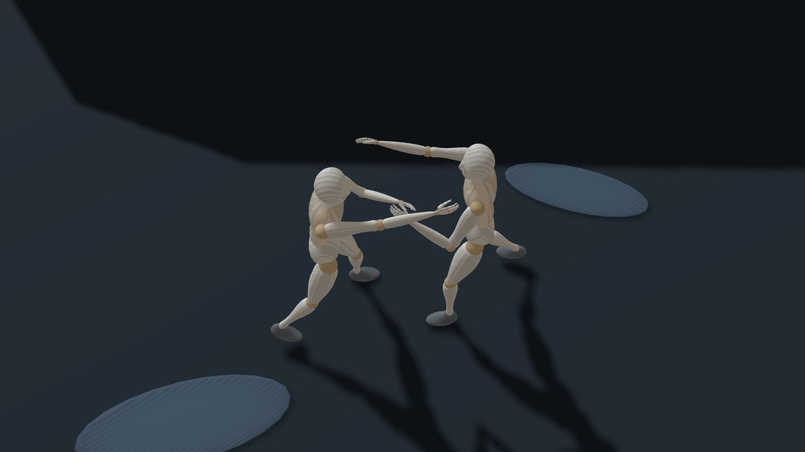
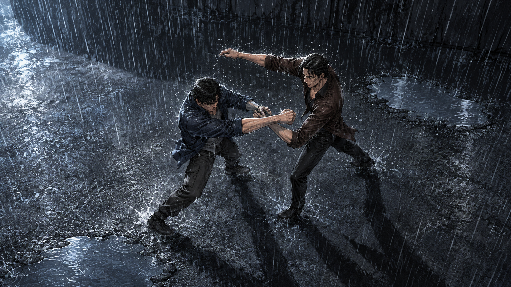

# 예제와 결과 갤러리

[사용 영상](demo/cutscene-studio-demo.webm) · [영상 시나리오](DEMO_SCENARIO.md) · [처음 실행하기](../README.md)

## 1. 빗속 액션: 장면 → 참조 → 작화

영화 장면을 출발점으로 만든 추정 블로킹 실험이다. 원본 영화 프레임을 직접 대조한 복원물이 아니다. 최종 그림은 배우 외형 대신 새로운 성인 캐릭터로 작화했다.

| 편집기 참조 | 외부 이미지 생성 결과 |
| --- | --- |
|  |  |

[장면 JSON](../app/saved/nowhere-to-hide-rain/scene.json) · [정밀 프로젝트](../app/saved/nowhere-to-hide-rain/project.json) · [전달 묶음](../app/saved/nowhere-to-hide-rain/cutscene-handoff.json) · [작화 지시와 결과 확인](../app/saved/nowhere-to-hide-rain/art-direction-v1.txt)

`장면 JSON 열기`에는 scene.json을, 상단 `Load`에는 project.json을 사용한다. 캡처와 최종 그림은 편집 단계가 다른 결과다. 생성 모델은 손발·동작·명암을 바꿀 수 있으므로 나란히 대조한다.

## 2. 빗속 우산: 여러 인물과 낮은 카메라

[장면 JSON 다운로드](../app/saved/holiday-umbrella/scene.json). 서 있는 인물, 무릎 꿇은 상대와 뒤쪽 두 인물을 배치한다. 영화 원본 확인 없이 작성한 구도 초안이며, 우산은 대리 도형을 쓴 초기 예제다. 원본 장면의 정확한 복원이나 최종 작화 결과로 분류하지 않는다.

## 3. 조명·깊이 전달 비교 실험

개발 과정에서 어떤 참조가 잘 전달되는지 살펴본 반복 생성 기록이다. 성공한 샘플만으로 일반적인 성능을 주장하지 않는다.

- [아래 조명: 조건별 생성 결과와 채점](review-evidence/2026-11-06-llm-ablation/E1-under-light/results/scores.md)
- [높이·깊이: 조건별 생성 결과와 채점](review-evidence/2026-11-06-llm-ablation/E2-depth-heights/results/scores.md)
- [카메라 기울기·누운 자세·광원 표시 실험](review-evidence/2026-11-11-feature-ablation-v2/C1-dutch-lying/RESULTS.md)

실험 폴더에는 입력 패스, 질문, 결과 이미지와 평가가 함께 있다. `off/on` 조건은 특정 입력만 바꾼 비교다. 수동 평가는 표본이 작고 생성 도구·시점에 의존한다.

## 4. 직접 열어볼 기본 예제

- [기본 두 인물 장면](../examples/example-scene.json)
- [포즈 예제 모음](../examples/poses)
- [전등 앞에 줄 선 인물](../scripts/fixtures/llm-scenarios/s2-queue-lamp.json)
- [식탁과 스포트라이트](../scripts/fixtures/llm-scenarios/s3-dinner-spot.json)
- [세로 구도와 역광](../scripts/fixtures/llm-scenarios/s4-backlight-vertical.json)

[개발 문서 목록](DEVELOPMENT.md)에서 인체, 조작, 패키지와 회귀 검증의 변경 과정을 볼 수 있다.
