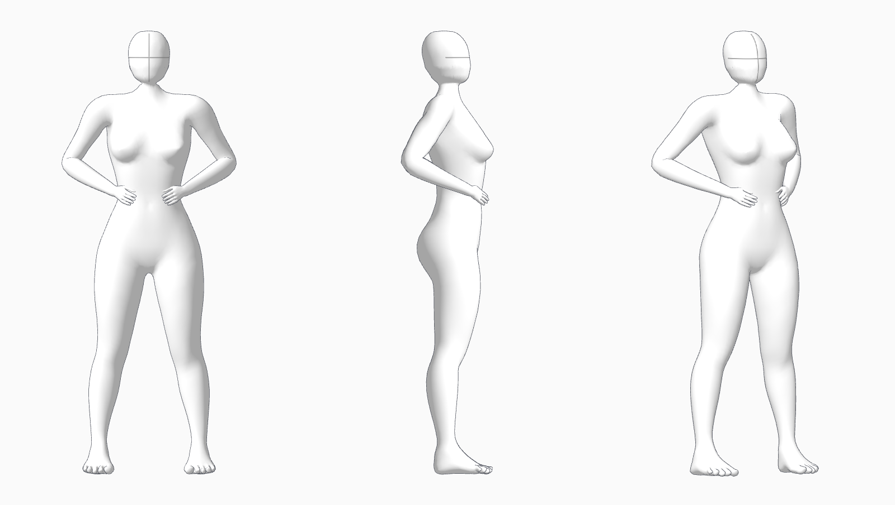

# AI Pose Gallery를 참고한 인체 비례

> 이전 연속 피부 모형의 기록입니다. 현재는 사용자 요청에 따라 [관절별 작화 인체](SEGMENTED_BODY.md)를 사용합니다.

2026-11-02. [참고 갤러리](https://ai-pose-gallery.pages.dev/)의 표준 전신 P018 정면·측면을 실제 브라우저에서 확인하고, 얼굴 없는 머리·허리·골반·팔다리의 실루엣을 기준으로 인체 표시를 교체했습니다. 원본과 완전히 같아졌다는 판정은 하지 않았습니다.

## 외형부터 확인하기

실행 중인 로컬 앱에서 **[인체 외형 비교](http://127.0.0.1:3001/model-preview.html)**를 여세요. 편집기 상단의 같은 이름 버튼으로도 열 수 있습니다.

- 정면·측면·사선을 같은 체형과 자세로 비교합니다.
- 기본 175cm·8등신이며, 5/8/9.5등신과 키를 바꿔 확인할 수 있습니다.
- 양손 허리·서기·팔 올리기·앉기, 마우스로 회전 보기, PNG 저장을 제공합니다.
- 비교 화면은 별도 시안이며 기존 편집기 장면을 변경하지 않습니다. 양손 허리는 비교용 근사 자세입니다.
- WebGL이 비활성화된 브라우저에서는 8등신의 실제 정적 3면 렌더를 표시하고 3D 조작을 비활성화합니다. Chrome에서는 3D 조작을 검증했습니다. 이는 내장 브라우저에서 직접 관측한 WebGL 생성 실패에 대한 처리이며 PC 전체의 GPU 유무를 판정한 결과는 아닙니다.

편집기는 Ctrl+F5 후 **갤러리 비례 · 인체**를 사용합니다. 선택 인물의 **여성형 작화 체형** 버튼은 가슴 볼륨을 활성화하고, 키·등신은 현재 값을 유지합니다. 기본형은 가슴을 줄인 표면을 사용합니다. 관절 조작점은 기존처럼 선택 인물의 포즈 편집 때만 표시합니다.

## 도형 조합에서 연결된 메시로 변경

기존 구·원통형 부위 조합을 대신해 **어깨·겨드랑이·흉곽·골반·팔다리가 하나로 연결된 인체 메시**를 사용합니다. MakeHuman CC0 기본 인체와 성인 체형·비례·가슴 형태 데이터에 기반하며, 얼굴 부분을 목 경계에 연결된 단순 머리로 다시 구성했습니다. 프로그램 코드는 복사하지 않았습니다.

몸과 머리는 하나의 닫힌 표면입니다. 10,000정점·19,996삼각형이며, 기존 46개 바인딩·관절 제한·고정 뼈 길이를 사용합니다. 본체·윤곽선은 2 draw calls / 39,992 렌더 삼각형입니다. FPS 개선률은 측정하지 않았습니다. 비교 화면과 편집기는 화면이 바뀔 때 렌더하며 유휴 GPU 그리기 0을 확인했습니다.

가슴 높이·간격·볼륨에는 원본 모델의 형태 변형 데이터를 사용합니다. 전달 묶음의 가슴 기준점도 **현재 변형 메시의 가중 중심**에서 다시 계산하여 몸통을 따라 이동시킵니다. 검출한 해부학적 랜드마크나 유두 좌표가 아닙니다. 형태 변형 과정에서 중심의 다른 축도 조금 바뀔 수 있습니다.

출처·고정 커밋·원본 SHA-256·적용한 변형 계수는 `app/src/assets/gallery-human.source.json`에 있습니다. [MakeHuman 라이선스 구분](https://github.com/makehumancommunity/makehuman/blob/a8bc2d54ff0ac92e78ff71431b1023eda42bf482/LICENSE.md), [CC0 전문](../app/public/licenses/MakeHuman-ASSETS-CC0.txt). `node scripts/build-gallery-human.mjs --download`로 고정 원본을 받아 해시 검사·오프라인 가공을 재현할 수 있습니다. 일반 앱에는 모델 다운로드나 Python 설치가 필요 없습니다.

갤러리 이미지를 일괄 다운로드하거나 앱에 포함하지 않았습니다. 이 문서의 PNG는 별도 CC0 데이터에서 가공한 앱의 실제 3D 렌더입니다.

## 실제 실행 검증

[JSON·이미지 증거](review-evidence/2026-11-02-gallery-body/). 소스 서버 3002와 빌드 서버 3001을 Chrome에서 실행했습니다.

| 검사 | 결과 |
|---|---|
| 기존 단위 19개 + 현행 메시 검사 3개 | 22/22 통과 |
| 현행 몸·머리 연결과 경계 | 연결 성분 1개, 모든 모서리가 면 2개에 연결됨 |
| 실제 비교 화면과 빌드된 비교 페이지 | 3면 렌더·PNG 저장·키/등신·자세·보기 조작 통과 |
| 가슴 높이·간격·볼륨 | 실제 메시와 기준점 변경, 고정 뼈 길이 보존 |
| 5/8/9.5등신과 체형 재설정 | 중립 표면 키 오차 5mm 미만, 재설정 후 리그 보존 |
| 중립·웅크림·무릎꿇기·팔 올리기·비틀기·눕기 | 유한 정점·뼈/루트 보존·현재 변형 외곽 일치, 컬러/깊이 마스크 IoU 1.0 |
| 직접 인물·무릎·발목 조작, 포즈 라이브러리 | 소스/배포본 통과 |
| 가슴·Save/Load·Undo/Redo·From File·전달 묶음 | 통과 |
| 단독 편집·전체 장면 캡처·대상 설명·카메라 | 통과 |
| 변환 포즈 1,001개와 보정 포즈 1,398회 적용 | 통과, 기존 미해결 분류 유지 |
| WebGL 없는 비교 화면 | 정적 3면 렌더 표시·3D 조작 비활성화·미처리 예외 없음 |
| 프로덕션 빌드 | 편집기와 비교 페이지 모두 성공 |

검사는 조작과 데이터 보존을 확인합니다. 원본 그림과의 시각적 동일성이나 모든 자세의 해부학적 정확성을 통과 판정한 것은 아닙니다. 깊은 관절 접힘·강한 비틀림에는 눌림·자기 침투가 남을 수 있습니다. 기존 261개 미해결 포즈를 이번 모형 교체로 해결 처리하지 않았습니다.
