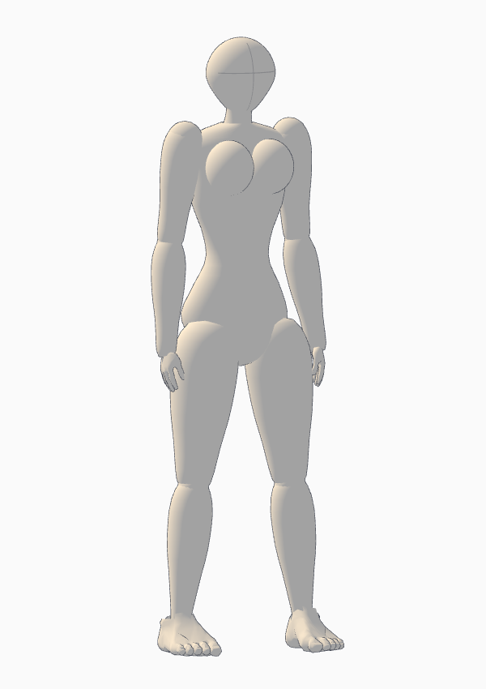
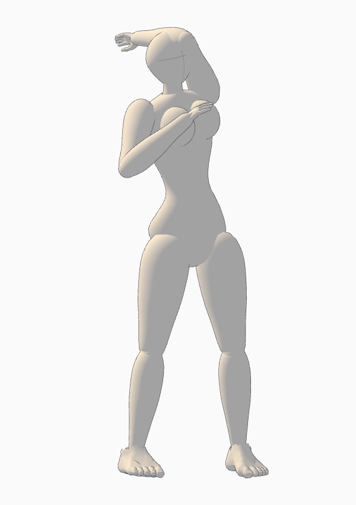

# 작화용 인체 모형

> 이전 부위 볼륨 방식의 기록입니다. 현재는 [갤러리 비례·연결된 인체](GALLERY_PROPORTIONS.md)를 사용합니다.

2026-11-02. 사용자 레퍼런스의 단순한 머리·흉곽·허리·골반·팔다리 볼륨을 기준으로 기본 모형을 다시 구성했습니다. 이전의 사실적인 얼굴·피부 표면을 대신해 작화 시 자세와 비율을 읽는 데 집중한 형태입니다.

## 사용

`http://127.0.0.1:3001`을 Ctrl+F5로 새로고침하세요. 상단 **인체 표시 → 작화용 인체 · 윤곽선**이 기본입니다.

1. 인물을 선택합니다.
2. 오른쪽 **여성형 작화 체형**으로 잘록한 허리·넓은 골반·가슴 볼륨을 적용합니다. **기본 작화 체형**으로 가슴 없는 기본 볼륨으로 돌아옵니다. 키·등신은 현재 입력값을 사용합니다.
3. 가슴 높이·간격·돌출은 기존 **가슴 형태 참조**에서 개별 조정할 수 있습니다.
4. 인물을 통째로 옮기거나 **포즈**에서 무릎·발목 등을 조절합니다. 조작점은 포즈 편집 때 선택 인물에만 나타납니다.

첨부 이미지의 실루엣 방향을 참고한 3D 볼륨 구현입니다. 눈·코·입이 없는 머리와 얼굴 방향 십자, 둥근 흉곽과 골반, 굵기가 변하는 허벅지·종아리·팔을 사용합니다. 윤곽선은 편집점과 별개인 모형 표현입니다. 기본형과 여성형의 머리·몸통·팔다리는 코드로 생성하며, 손·발에는 앞서 출처를 기록한 CC0 데이터 일부를 유지했습니다.

기존 46개 바인딩과 고정 길이 리그를 유지합니다. 새로운 여성형 설정은 기존 `bodyProfile.chest`를 사용하므로 Save/Load·Undo/Redo·포즈 저장 포맷을 바꾸지 않습니다. 가슴 설정이 없는 기존 프로젝트를 임의로 여성형으로 바꾸지는 않습니다.

## 실행 검증

실제 Chrome 소스(3002)와 빌드 앱(3001)에서 확인했습니다. [증거 JSON·렌더](review-evidence/2026-11-02-illustration-body/).

- 여성형/기본형 적용, 선택 인물만 변경, 키·등신·뼈 길이 유지, Undo/Redo.
- 기본 화면 조작점 숨김과 포즈 편집 조작점 표시. 전체 인물·무릎·발목 드래그와 포즈 라이브러리 저장/적용.
- 5/8/9.5등신 표면 키, 체형 재생성, 6자세의 뼈·루트·유한 좌표와 컬러/깊이 마스크. 자세 변경 후 윤곽 메시의 외곽 캐시도 함께 갱신하는지 실제 변형 정점과 대조했습니다.
- 가슴 참조의 몸통 추종·저장/Load·전달 묶음, 설명·카메라·실제 컬러/깊이 내보내기.
- 단독 편집의 유휴 그리기 0과 전체 장면 캡처 보존.
- 기존 변환 포즈 1,001개 검사와 보정 포즈 466개 × 3체형 적용, 단위 테스트 19개, 프로덕션 빌드.

인물 1명은 본체·윤곽선 **2 draw calls**입니다. 고립된 기본형은 **37,164**, 여성형은 **40,236**삼각형을 렌더합니다. 기존 관절형의 97 calls / 20,220삼각형과 비교하면 호출 수는 줄고 삼각형 수는 늘었습니다. FPS 향상률을 측정한 결과는 아닙니다. 윤곽선은 본체와 정점 데이터를 공유하며 근사 겹침 검사·클릭 판정에서는 제외합니다.

부위 볼륨을 조합한 작화용 모형이라 관절·골반 경계와 깊은 접힘의 겹침은 남을 수 있습니다. 근육·연부조직의 물리 변형이나 모든 자세의 해부학적 정확성을 보장하지 않습니다. 원본 포즈와 현재 카메라의 연출 판단은 화면을 보며 조정해야 합니다.
