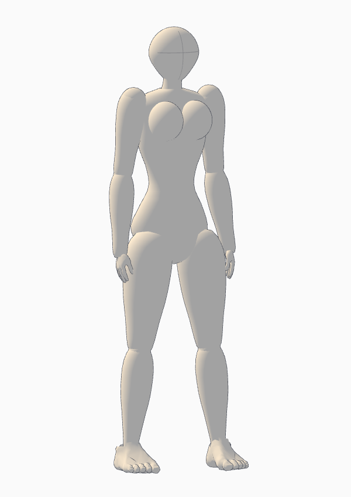

# 인체 표시·대상 설명·카메라 중심 이동

2026-11-02 사용성 개선. 앱에서 Ctrl+F5로 새로고침한 뒤 사용하세요.

## 카메라 중심 이동

3D 영역에서 **빈 곳 왼쪽 드래그 = 회전**, **오른쪽 드래그 = 화면 중심 이동**, **휠 = 줌**입니다. 인물 위 왼쪽 드래그는 대상 조작으로 쓰므로 구분해야 합니다.

- **화면 중심 이동**: 켜면 왼쪽 드래그도 화면을 이동합니다. 인물·소품·관절은 움직이지 않습니다. 다시 누르면 대상 조작으로 돌아갑니다. 켜진 동안 중심 십자와 파란 버튼으로 상태를 표시합니다.
- **선택 대상으로 중심**: 선택한 대상의 실제 외곽 중심을 회전·줌 중심으로 잡습니다. 카메라 각도와 거리는 유지합니다.
- **전체 보기**: 단독 포즈 편집에서 나와 모든 인물·소품을 담도록 중심과 거리를 맞춥니다.

포즈 단독 모드의 카메라는 편집용이며, 기존 작업 카메라와 촬영 컷을 보존합니다. **화면을 움직였다고 저장된 촬영 컷이 자동 변경되지는 않습니다.** 원하는 구도를 찾은 뒤 왼쪽 카메라 컷의 **갱신**을 누르거나 **구도 저장**으로 새 컷을 만드세요.

## 작화용 인체 표시

상단 **인체 표시 → 작화용 인체 · 윤곽선**을 기본으로 사용합니다. 얼굴 없는 단순 머리와 방향 십자, 흉곽·허리·골반, 굵기가 변하는 팔다리를 표시합니다. 기본 화면에서 편집점을 숨기고 선택 인물의 **포즈** 편집 때만 조작점을 표시합니다. **기존 관절 마네킹**으로 비교할 수도 있습니다.

오른쪽 **여성형 작화 체형**은 현재 키·등신 입력값으로 선택 인물의 허리·골반·가슴 볼륨을 적용합니다. 가슴 높이·간격·돌출은 개별 조정합니다. **기본 작화 체형**은 가슴 없는 기본 볼륨을 적용합니다. 저장 포즈와 고정 길이 리그는 유지합니다.



부위 볼륨을 조합한 참고용 인체라 관절 경계와 깊은 접힘의 겹침이 남을 수 있습니다. 본체·윤곽선 2 draw calls를 사용합니다. 기본형은 37,164, 여성형은 40,236 렌더 삼각형으로 기존 관절형(20,220)보다 늘었습니다. FPS 향상률은 측정하지 않았습니다. [최신 구현·검증·제한](ILLUSTRATION_BODY.md).

## 선택한 대상의 설명

인물이나 소품을 클릭하면 오른쪽 **선택한 대상**에서 이름·종류·ID와 다음 설명을 확인하고 수정할 수 있습니다.

| 필드 | 용도 |
|---|---|
| 이름 | 어떤 대상인지 식별 |
| 역할 / 무엇인가 | 장면에서 맡는 역할 |
| 이 위치·자세에 둔 의도 | 왜 그곳에 놓았는지, 무엇을 바라보거나 표현하는지 |
| 최종 외형 설명 | 최종 이미지에 필요한 재질·색·복식·디자인 등 |

입력 후 다른 곳을 누르거나 Tab으로 나가면 자동 저장됩니다. Save/Load와 Undo/Redo에 포함됩니다. 예전 JSON에 설명이 없으면 **미작성**으로 표시하며, 앱이 소설의 의미를 임의로 만들어 넣지 않습니다.

**텍스트를 고쳐도 3D 모델의 크기·위치·포즈는 바뀌지 않습니다.** 예를 들어 큰 원형 탁자가 필요하다면 먼저 크기·형상·배치도 맞춰야 합니다. 단순 프록시의 색과 재질은 최종 작화 설명으로 교체할 수 있습니다.

새 장면 JSON의 actors와 props에 다음 선택 필드를 쓸 수 있습니다. 각 값은 12,000자 이하 문자열이어야 합니다. 기존 JSON도 계속 열립니다.

```json
{
  "role": "장면의 단서가 되는 작은 상자",
  "intent": "두 인물 사이 탁자 위에서 시선을 모은다",
  "description": "무광 붉은 금속, 직육면체, 로고 없음"
}
```

위 코드는 인물·소품 정의에 추가할 설명 부분이며 독립된 전체 장면 JSON은 아닙니다.

## 겹침을 해석하는 방법

**화면의 가림**과 **3D 공간 침투**는 다릅니다. 전경 소품이 인물의 일부를 가리는 것은 연출일 수 있습니다. 사람이 탁자를 뚫거나 상자가 다른 상자 안으로 들어간 경우는 물리 배치를 확인해야 합니다. 손을 탁자에 대거나 의자에 앉는 접촉은 의도한 관계일 수 있습니다.

최초 JSON은 구도와 배치의 초안이며 물리 시뮬레이션의 결과가 아닙니다. JSON 검사 통과가 무침투·정확한 접촉을 뜻하지 않습니다.

오른쪽 **현재 공간 겹침 검사**는 선택한 대상과 다른 대상의 부위별 방향 있는 외곽 상자를 비교합니다. 탁자 전체를 막힌 덩어리로 취급하지 않고 상판과 다리를 따로 검사해, 아래 빈 공간을 겹침으로 오인하는 경우를 줄였습니다. 전체 외곽의 각 축에 2cm 이상 겹침이 있어야 세부 검사하고, 부위 상자는 1cm씩 줄여 단순 표면 접촉을 제외합니다.

이는 **겹침 가능성 경고**입니다. 곡면·오목한 모델·변형 GLB에는 오탐과 누락이 있을 수 있습니다. 자동으로 밀어내거나 내보내기를 막지 않습니다. 측면·위 보기에서도 확인하고 의도하지 않은 침투라면 인물이나 사물을 옮겨 수정하세요. 경고가 없어도 정밀 접촉이 검증된 것은 아닙니다.

## LLM 전달 묶음

내보내는 순간의 최신 설명을 아래에 함께 담습니다.

- `objectDescriptions`: 현재 이름·역할·배치 의도·외형 설명, 현재 변환과 외곽, 연결할 editorState 배열/인덱스.
- `editorState`: 실제 수정한 관절·배치·체형·개별 설명(`sceneNotes`).
- `spatialReview`: 내보내는 시점에 다시 계산한 근사 공간 겹침 경고와 관련 대상 ID.
- `direction`: 최신 대상 설명을 포함한 작화 지시문. 작업용 인체/소품 표현과 최종 외형을 구분합니다.
- `proposal`: 최초 제안. 사용자 편집 설명으로 덮지 않습니다.

PNG 구도·크기·포즈·가림과 정밀 편집 상태를 공간 기준으로 유지하며, 캐릭터 정본과 최신 설명을 외형 기준으로 전달합니다. 설명만으로 새 사물·사건을 추가하거나 공간을 임의 변경하라는 뜻은 아닙니다.

## 실행 검증

프로덕션 빌드와 실제 Chrome에서 설명 수정·프로젝트 재열기·Undo/Redo·전달 묶음/작화 지시문·좌/우 드래그 중심 이동·선택 중심·전체 보기의 단독 모드 복귀를 확인했습니다. 키/등신·가슴 참조·기존 포즈 적용·전체 장면 캡처 회귀 검사와 단위 테스트 19개를 통과했습니다. 연속 인체 변경 후의 추가 증거는 [최신 검증 기록](review-evidence/2026-11-02-illustration-body/)에 보관합니다.
