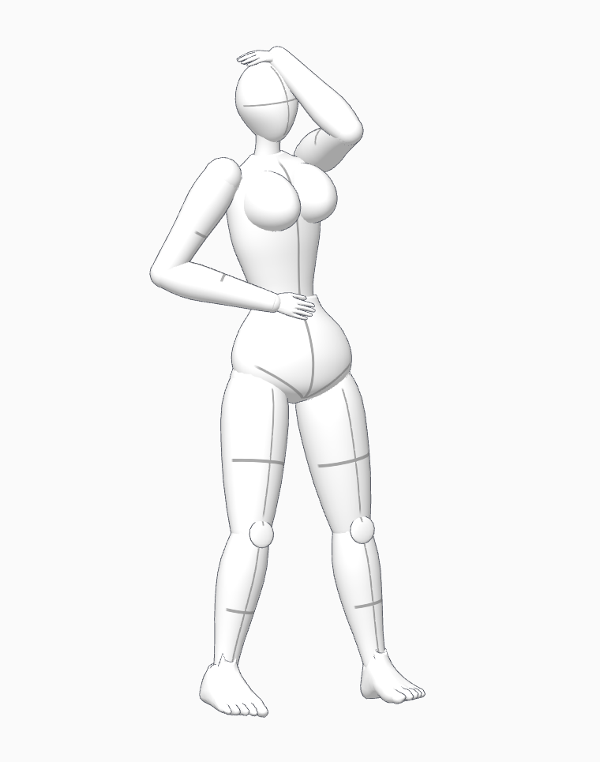
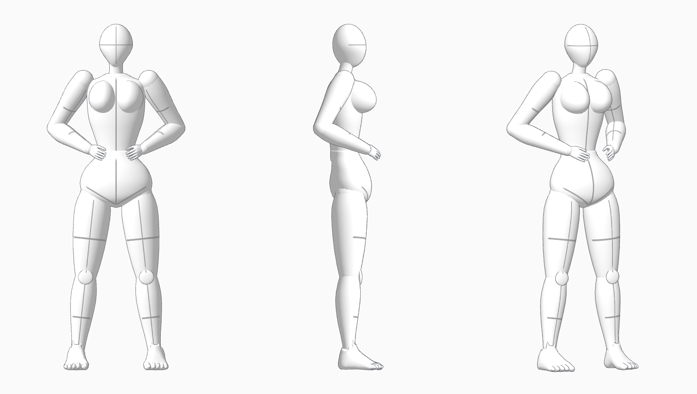

# 관절별 작화 인체

2026-11-03. 사용자 요청에 따라 흉곽·골반·팔다리를 각각 형태가 유지되는 부위로 구성하고 관절에서 연결했습니다. 이전 연속 피부 방식에서 볼륨이 흐려지고 관절을 접을 때 함께 찌그러지는 문제를 줄이기 위한 변경입니다. 원본 그림과 시각적으로 완전히 일치했다고 판정하지 않았습니다.

## 확인과 사용

[인체 외형 비교](http://127.0.0.1:3001/model-preview.html)를 Ctrl+F5로 새로고침하세요. 자세에서 **한팔 머리 위 · 손을 허리에**를 선택하면 처음 주신 그림과 비슷한 배치에서 정면·측면·사선을 비교할 수 있습니다. 정확한 원본 포즈 재현을 판정한 결과는 아닙니다.

- 편집기 상단 **인체 표시 → 관절별 작화 인체**를 사용합니다. 여성형은 인물 선택 후 **여성형 작화 체형**으로 적용합니다. 기본 가슴 높이를 비교 화면과 동일한 65%로 맞췄습니다.
- **인체 구조선**으로 흉곽·골반 중심선과 팔다리 방향·단면선을 켜거나 끕니다. 편집기 표시 선택은 브라우저에 저장됩니다. 비교 화면의 구조선 토글은 기존 편집기 장면이나 설정을 변경하지 않습니다.
- 가슴 높이·간격·돌출, 키·등신, 저장 포즈와 기존 직접 편집을 계속 사용합니다. 가슴 기준점은 현재 부위 형상 정의의 기준점이며 검출한 해부학 좌표가 아닙니다.
- 무릎·발목 등의 편집용 조작점은 포즈 편집 시 선택 인물에만 표시합니다. 모형의 관절 연결부와 구조선은 조작점과 별개입니다.
- WebGL이 없는 환경에서는 새 모형의 실제 정적 8등신 3면 렌더를 표시합니다. Chrome의 3D 조작과 이 대체 화면을 각각 검증했습니다.

## 구현

흉곽·골반·머리·목·상완·전완·허벅지·종아리를 단순 구나 동일 굵기 원통 대신 높이별 단면과 중심 곡선으로 구성했습니다. 허리 수축, 골반 폭과 뒤쪽 볼륨, 위쪽 허벅지 볼륨, 종아리에서 발목으로 좁아지는 형태를 각각 정의합니다. 가슴은 흉곽에 붙는 별도 비대칭 볼륨으로 구성하여 흉곽과 함께 회전합니다.

손·발은 기존 CC0 인체 데이터에서 해당 영역을 잘라 재사용하고 절단 경계를 닫았습니다. 손가락 스키닝은 손 안에서 유지합니다. 몸통·팔다리·발 등 14개 영역은 한 관절에 묶어 회전 중 모양과 치수를 유지합니다. 둥근 연결부와 무릎 앞쪽 덮개가 회전 경계를 가립니다. 기존 46개 바인딩과 관절 제한·고정 뼈 길이를 유지하며 프로젝트 JSON 포맷은 바꾸지 않았습니다.

렌더링할 때는 부위들을 한 메시로 모아 본체·윤곽선 2회로 그립니다. 개별 부위의 경계가 연결 피부처럼 늘어나는 방식은 아닙니다. 여성형 기본 설정은 11,220정점·22,312삼각형이며 윤곽 포함 44,624 렌더 삼각형입니다. FPS 개선률을 측정한 결과는 아닙니다. 현재 공유 JS 청크는 약 1.21MB / gzip 343KB이며, 이전 연속 인체용 가슴 변형 데이터는 일반 앱 번들에서 제외됐습니다.

핵심 구현은 `app/src/segmented-body.js`, 손·발 출처는 `app/src/assets/reference-human.source.json`입니다. [기존 CC0 고지](../THIRD_PARTY_NOTICES.md)와 [라이선스](../app/public/licenses/MakeHuman-ASSETS-CC0.txt)를 유지합니다. 갤러리 원본 이미지를 배포하지 않았습니다.

## 실제 실행 검증

[검증 JSON과 PNG](review-evidence/2026-11-03-segmented-body/). Chrome 소스 서버 3002와 배포 서버 3001에서 실행했습니다.

| 검사 | 결과 |
|---|---|
| 부위 내 치수 유지 | 14개 강체 영역, 266개 거리 표본 × 6자세; 최대 편차 3.47e-16m |
| 절단면·생성 부위 경계 | 부위별 좌표를 합쳐 검사한 열린 모서리 0개 |
| 중립·웅크림·무릎꿇기·팔 올리기·비틀기·눕기 | 뼈·루트·유한 정점·현재 외곽 보존; 컬러/깊이 마스크 IoU 1.0 |
| 가슴·5/8/9.5등신·구조선·포즈 예시 | 실제 형상 변경과 PNG 내보내기 통과 |
| 직접 인물·무릎·발목 조작, 저장 포즈 | 소스·배포본 통과 |
| Save/Load·Undo/Redo·From File·가슴 전달 기준점 | 통과 |
| 전체 장면 컬러·깊이 캡처, 설명·카메라 | 통과 |
| 기존 변환 포즈 1,001개·보정 포즈 1,398회 적용 | 통과, 기존 미해결 분류 유지 |
| 기존 형식·설명·CC0 자산 단위 검사 | 22/22 통과 |
| 프로덕션 빌드·비교 화면·WebGL 대체 화면 | 통과 |

구조선 표시 변경이 실제 렌더를 바꾸는지도 확인했습니다. 단위 테스트의 기존 연결 표면 검사는 CC0 원본 자산을 검사하며, 현행 모형 전체가 단일 연결 피부라는 뜻은 아닙니다. 현행 부위 구조는 별도의 브라우저 검사에서 확인했습니다.

부위 경계와 깊게 접힌 자세의 겹침은 남을 수 있습니다. 이는 부위별 볼륨이 고정된 작화용 모형이며 피부·근육 접촉 시뮬레이션은 아닙니다. 열린 절단면이 없다는 검사도 자기 침투가 없음을 보장하지 않습니다. 손·발 절단부는 둥근 연결부로 가리지만 일부 각도에서 경계가 보일 수 있습니다.
